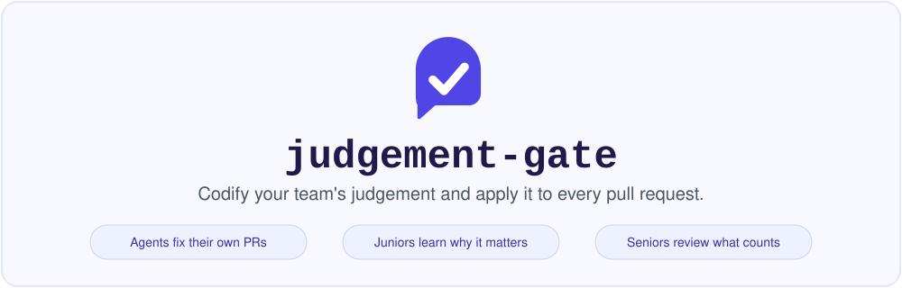

<h1 align="center">
  <picture>
    <source media="(prefers-color-scheme: dark)" srcset="assets/hero-dark.svg">
    
  </picture>
</h1>

Agentic coding writes code faster than people can build the judgement to review it. Judgement (is this reversible? does this break a consumer?) is hard to teach and hard to automate. Linters can't check it, because it depends on business logic and intent. Models like TypeSafe's Jev can answer these questions, so you can write the judgement down once and apply it to every PR, whether a person or an agent wrote it.

The gate also teaches. A failure comment says *why* the change matters and *how* to clear it, so an agent can fix its own PR and a new engineer learns what the team cares about.

It runs as a Cloudflare Worker (free tier). A GitHub App sends `pull_request` webhooks; the Worker asks Jev (via OpenRouter) a set of **judgements** about the change and posts one `judgement-gate` check run. No files needed in any repo.

## Judgements

A judgement is a named question, a threshold, a way for the author to clear it, and a remedy. One is built in, `one-way-door`: Type 1 (one-way) changes need a new ADR in `docs/decisions/*.md` (added by the PR; editing an old one does not count); Type 2 (reversible) changes need a Reversal Trigger and Rollback Path in the PR body. Add your own in YAML:

```yaml
judgements:
  - use: one-way-door
  - id: public-api-contract
    name: Public API contract change
    question: "Does this change break or remove a public API contract?"
    true: "removes/renames endpoints, fields or exported symbols"
    false: "additive or internal only"
    threshold: 0.6
    applies_to: ["services/api/**"]
    satisfied_by:
      - pr_body_matches: "(?i)^Migration Plan:"
    why: "Consumers cannot roll back with us. Breaking changes need a migration plan."
    fix: "Add a 'Migration Plan:' line to the PR description."
```

A judgement can also carry `probes`, short questions a reviewer will ask, shown in the comment and the agent block; the built-in `one-way-door` ships defaults you can override.

A PR that only touches docs, images or lockfiles skips the built-in `one-way-door` with no model call, and bot-authored PRs are judged like any other; `ignore:` changes this per judgement. See [Safe paths and `ignore`](docs/configuration.md#safe-paths-and-ignore).

Full reference: [docs/configuration.md](docs/configuration.md).

## Severity

`one-way-door` asks whether a change can be undone. **Severity** asks a different question: how bad is it if this change is wrong? A reversible change to checkout can be P0; an irreversible change to an internal admin table can be P3. Your org writes the levels and what each means (P0 to P3, Sev1 to Sev4, anything), because companies disagree about it, and the gate ships no default rubric. The model picks one level per PR.

```yaml
  - id: severity
    name: Severity
    classify:
      question: "If this change is wrong, how bad is the impact?"
      levels:               # most severe first
        - { id: P0, means: "customer-facing outage, data loss, or security exposure" }
        - { id: P1, means: "major feature broken for many users, no workaround" }
        - { id: P3, means: "internal or cosmetic; no customer impact" }
    applies_to: ["services/**"]
```

Severity informs and never fails the check: there is nothing for an author to "clear". The level appears in the check summary (`pass: Severity (P1)`), in the remediation comment when one is already posted for a failing judgement, in the hidden agent block, and in analytics. Nothing acts on it yet, and it does not affect review routing. See [docs/configuration.md](docs/configuration.md#severity).

## Review routing

Besides the check, the gate recommends who should review the PR: a **human** or an **agent**. By default a Type 1 result (a one-way door, even one with an ADR) or an ambiguous one routes to a human. An ADR shows that someone wrote the decision down, not that someone accountable accepted it, so a person still needs to look. You can add your own rules in the same YAML file, by judgement, by reason code or by changed-file glob.

Routing recommends and never changes the check: pass, fail and neutral are the same with or without it. A `human` result adds a PR label (default `needs-human-review`) and a `Review routing:` line to the check summary. When the gate posts a remediation comment, it also shows a `Review routing:` line there, in words (human, agent, or could not be decided), so the author sees why. A PR that passes every judgement but routes to a human (for example Type 1 with an ADR) gets a short comment of its own, in the same place, that says a person will review it and why, with the questions a reviewer will ask; it is posted in shadow routing mode too, worded as a recommendation. A passing PR routed to an agent gets no new comment. If a gate comment already exists, it is updated in place to a short passing note, with no failing judgements in the hidden agent block. The gate never removes the label; a person does. The gate does not require the review itself. To enforce it, use CODEOWNERS or a small workflow in your repo; see [docs/configuration.md](docs/configuration.md#review-routing).

Routing has its own mode, `ROUTING_MODE` (`shadow` or `enforce`), which defaults to `MODE`. In shadow mode the gate never labels: it reports "would have routed to a human" in the summary and records the result. The label write uses the **Issues: read & write** permission the app already has for comments, so there is no new permission.

AI agents: each comment embeds a hidden JSON block saying how to clear every failing judgement; see [docs/agents.md](docs/agents.md).

## Demo in 2 minutes (no GitHub App needed)

Real Worker, real Jev call, fake GitHub.

```bash
npm install
OPENROUTER_API_KEY=sk-or-... node scripts/init-dev-vars.mjs   # writes .dev.vars (gitignored)
npm run mock-github      # terminal 1: fake GitHub API on :8788
npm run dev              # terminal 2: Worker on :8787
npm run simulate -- 1    # terminal 3: send a signed webhook
```

| Scenario | PR | Expected |
|---|---|---|
| 1 | drops a column, no ADR | FAILURE + ADR comment, routed to a human (label `needs-human-review`) |
| 2 | same, with `docs/decisions/*.md` | SUCCESS, routed to a human (label `needs-human-review`) + a comment saying why a person reviews it |
| 3 | flagged feature, has reversal plan | SUCCESS, routed to an agent |
| 4 | flagged feature, no plan | FAILURE + 3-line comment, routed to an agent |
| 5 | breaks a public API, no migration plan (uses `examples/judgement-gate.yml`) | FAILURE: API-contract judgement fails (one-way door usually reads "Ambiguous" too); routed to a human (`public-api-contract` is in `human_when`) |
| 6 | same, with `Migration Plan:` in the body | API-contract judgement passes; one-way door can still read "Ambiguous" and fail the check; routed to a human (`public-api-contract` is in `human_when`) |
| 7 | reversible, flagged change under `services/checkout/` with a reversal plan (uses `examples/judgement-gate.yml`) | SUCCESS; the summary has a `Severity (P?)` line, whatever level the model picks |

The mock logs `LABEL added on #n: ...` when the gate labels a PR (scenarios 1 and 2 also match the `migrations/**` rule in the example config). Scenarios 5 to 7 are about the per-judgement lines in the check summary, not the overall result. Borderline PRs like these pass if you lower `CONFIDENCE_THRESHOLD`; tune it in shadow mode. The mock serves `examples/judgement-gate.yml` as the org config; set `MOCK_CONFIG=path` to try your own, and edit `scripts/scenarios.mjs` to add scenarios.

`npm run e2e` runs scenarios 1 to 7, plus fail → pass → repeated pass → fail transitions on the same PR, Jev outage and bad-severity cases, against the real Worker (`wrangler dev`), the mock GitHub and a scripted stand-in for Jev, all on free local ports with no secrets, and checks what the mock recorded. It is what the `e2e` CI job runs; see [docs/operations.md](docs/operations.md#end-to-end-run).

`npm run jev-smoke` calls Jev directly to verify your key. `npm test` runs the unit and end-to-end tests. `npm run typecheck` runs tsc.

## Deploy for real

1. Create a GitHub App: webhook URL `https://<worker>.workers.dev/webhook`, a webhook secret, permissions **Checks: read & write**, **Pull requests: read**, **Issues: read & write** (comments and the review-routing label), **Contents: read** (to read the org judgement config), subscribe to **Pull request** and **Issue comment** (the second lets people reply `/judgement-gate false-positive <id>` to a flag; no new permission needed, and without it only the false-positive log is lost). If any repo uses a merge queue, also subscribe to **Merge group**; without it a required `judgement-gate` check never reports on the queue's merge commit and the queue stalls (see [docs/operations.md](docs/operations.md#merge-queue)). Install it on the org or a test repo, including the org's `.github` repo if you use org-level judgements.
2. Convert the downloaded key to PKCS#8 (Web Crypto cannot import the PKCS#1 key GitHub gives you):
   `openssl pkcs8 -topk8 -nocrypt -in app.pem -out app-pkcs8.pem`
3. Set secrets, then deploy:
   ```bash
   npx wrangler secret put GITHUB_WEBHOOK_SECRET
   npx wrangler secret put GITHUB_APP_ID
   npx wrangler secret put GITHUB_APP_PRIVATE_KEY < app-pkcs8.pem
   npx wrangler secret put JEV_API_KEY        # your OpenRouter key
   npx wrangler deploy
   ```

## Suggested rollout

1. **Shadow on a few repos (2 weeks).** `MODE = "shadow"` is the default: the check always passes. Pick repos with real migrations, infra changes and agent-authored PRs.
2. **Review the flags with the team.** Would we have caught this? Was the flag wrong? Use the answers to tune thresholds.
3. **Make the check required, still in shadow mode.** Add an organisation ruleset that requires `judgement-gate` on one willing repo while `MODE = "shadow"`. Every PR passes, so this only proves the check always reports. Then set `MODE = "enforce"`.
4. **Add judgements** each time review catches something the gate missed.

Making the check required is the risky step: a required check that never reports blocks merges. The gate completes its check run even when evaluation fails (a `neutral` `[Audit Degraded]`, so it fails open), ignores draft PRs, and answers merge queue runs without re-evaluating. The one case it cannot cover is when GitHub will not even create the check run. [docs/operations.md](docs/operations.md#rolling-out-the-required-check-safely) lists these decisions, the ruleset settings to use, and how to back out.

More in [docs/operations.md](docs/operations.md).

## Data and privacy

For each PR event the Worker sends Jev (through OpenRouter) the PR title and body, the changed-file list, and a diff capped at 50KB (shared fairly between files; a PR too big to send in full is flagged as ambiguous). The Worker stores nothing. Check that this is acceptable for your repos, and use the app's repository selection to limit where it runs.

## Status

Alpha. The Jev API (`/api/alpha/decisions`) may change, Jev's confidence score is not a probability, and the gate fails open: if Jev is unavailable the check is `neutral` and the PR is not blocked. Missing or malformed required answers degrade only their own judgement: a healthy failure still fails the gate in enforce mode; with no failures, incomplete coverage is `neutral`. See [partial answer degradation](docs/operations.md#partial-answer-degradation). Evaluations and false-positive replies are logged to Workers Analytics Engine (optional) so shadow-mode thresholds can be tuned from data; see [docs/calibration.md](docs/calibration.md).
